# Lapis

*Ultramarinus: "beyond the sea".*

A dreamlike open-world exploration game that looks like a moving drawing. You wake on a moonless beach in an archipelago where the stars are falling into the sea, and the only way home is to put them back, before the night, the cold and her nightmares close in.

Runs in the browser on WebGPU. Built with Three.js, TypeScript and a lot of hand-written shaders; every model is generated by Python scripts in headless Blender, and every sound effect is synthesised from noise.

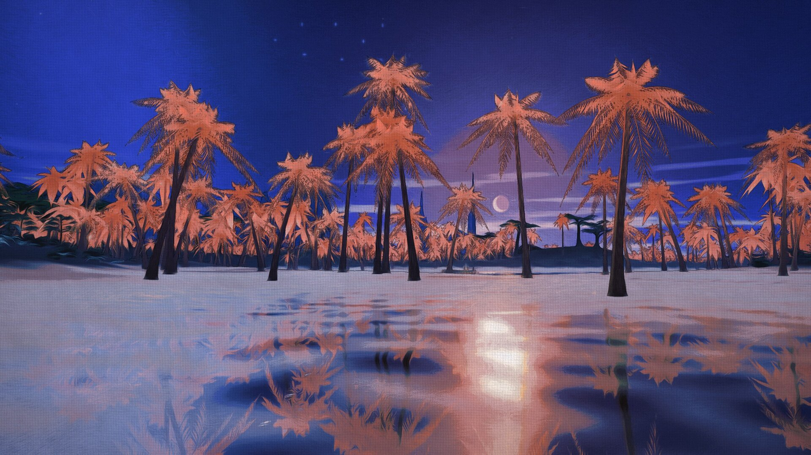

---

## The story

> Every night, she asked for the same story.
> The one about the islands where the stars fall into the sea,
> and the palms glow pink from drinking their light.
> Now she is the one lost at sea, and her stars are falling.
> Light her sky again, and she will find her way home.

You are the Keeper. Your daughter Mara is adrift, and the sky she steers by is going dark: one by one, her stars are falling into the islands of the bedtime story you used to tell her. Each fallen star holds a memory of her, at the age she was when she said it. Gather them, carry them to a lighthouse, and lift them back into her sky.

Mara is the only voice in the game. The Keeper never speaks and is never seen. There is more to the story than that, and the game keeps its secret until the end.

**Memories of the real world.** Most stars hold a short film of the life the dream is built from: father and daughter on their island, at sea and at home, from bedtimes at four to the night of the crossing at seventeen. 38 films, each a few seconds long, painted and hazed so they feel remembered rather than recorded, with her line captioned as it plays. Pieced together, they tell you what really happened.

<p align="center">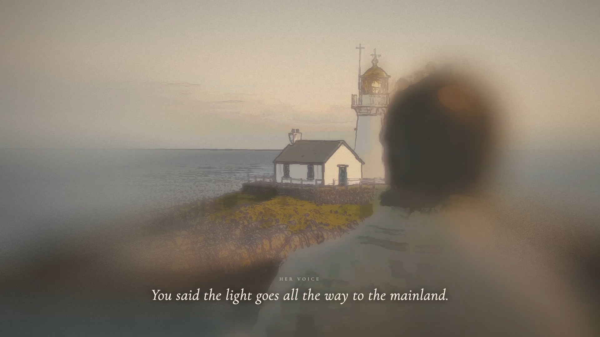</p>

<p>
  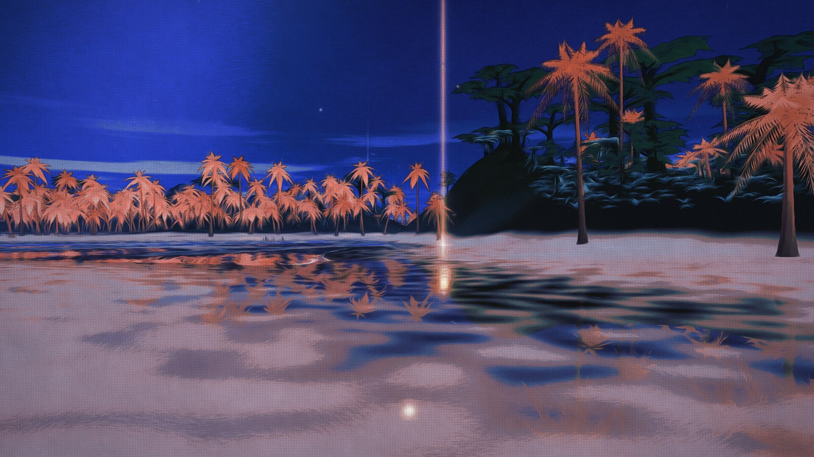
  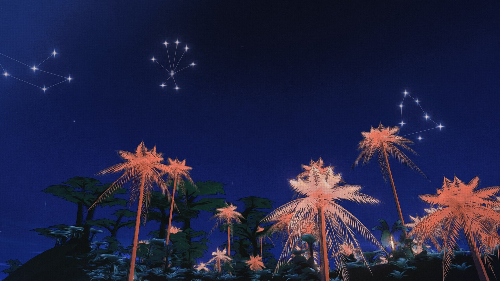
</p>

---

## How it plays

**Light five constellations.** The sky holds five constellations, one over each region of the island. They hang there faint and cold so you can see the shapes you are working toward. 38 stars in all: some lie out in the open, some are hidden inside the region's wonder, some are guarded by puzzles.

**Carry them home before she wakes.** A gathered star is only carried, not kept. Bring it to a lighthouse, climb the spiral stair inside to the lamp room, and lift it into the sky. A night lasts about twenty minutes; if it runs out before you reach a light, the stars you were carrying fall back where you found them, and you wake at the last lighthouse you rested in. Resting is a short sleep in the lamp's glow that gives back the night, but less each time you rest at the same tower, so the island pushes you outward.

**Keep her warm, keep your light.** The dark is cold. Warmth drains in the dark, faster in the sea, in the wind and in the rain, and faster as the night grows late; only real light (lamps, huts, lighthouses) warms her back up. There's no health bar: the cold shows as frost creeping in from the edges, her breath in the air and the keepsake shaking in your hand, and the little light points you to the nearest warmth when it gets bad. Freeze, and you wake at your last light without the stars you carried. You also carry light itself, shown as a row of pips above your keepsakes. Gather it by walking through the glowing motes each region breathes out, or by holding the paper lantern up to something shining (mushrooms, moonflowers, crystals, the surf) until it dims. Spend it on the little light's flare.

**The night has teeth.** As each night grows late, nightmares crawl out of black thorn patches in the dark: ink wraiths and crawlers that stalk and lunge. They don't know where you are: they prowl, and they hear and see you. Running is loud, wading louder; creeping (hold C) through dark grass and bushes keeps you hidden, and their eyes smoulder while they search and blaze once they hunt. Late in the night they come in packs that try to cut you off from the nearest light. Near them the whole picture curdles toward bruised crimson and the score sinks under a dread track. A touch scatters what you carry; light burns them.

**The sea turns against her.** Dark Water, starless and reflectionless, creeps in from the horizon through the night, putting out the sparkles, greying the shore palms, thickening the mist and chilling anyone on it; every constellation you restore holds it back from that region. Squalls roll in off the sea, more often as the night wears on: slanting rain, roaring wind that pushes your boat and your glide, lightning, and a cold that sends you looking for shelter under a canopy or a giant mushroom. The rain also hides you from the nightmares.

**Three ways to play.** Survival is all of the above. Story keeps the nights and the stars to carry home, but the cold is slow, flares are free and the nightmares are few. Wander turns the night off entirely. Choose in the pause menu; the design is in [docs/SURVIVAL.md](docs/SURVIVAL.md).

**The little light.** A Navi-like companion that keeps you company, hovers over things worth finding, and speaks up with a bright little call. Ask it what to do next with F. After the opening, it only knows roughly where stars are: finding them is your job.

**Find her keepsakes.** Five of Mara's things are hidden one per region, each waiting somewhere of its own (a shell on a wet rock behind the falls, paper wings tied to a staff on the meadow heights, a lantern hung from a crook in the Lantern Wood, a compass on a half-buried chest in the dunes, a ribbon round a drowned post), and each is a tool: a seashell that hums near hidden stars, moth wings to glide, a paper lantern that holds nightmares back, a compass that puts you on the chart, a ribbon that makes the nights longer.

**When the last constellation is lit,** the brightest star blazes, and the River of Light carries you north to the end of the world.

<p>
  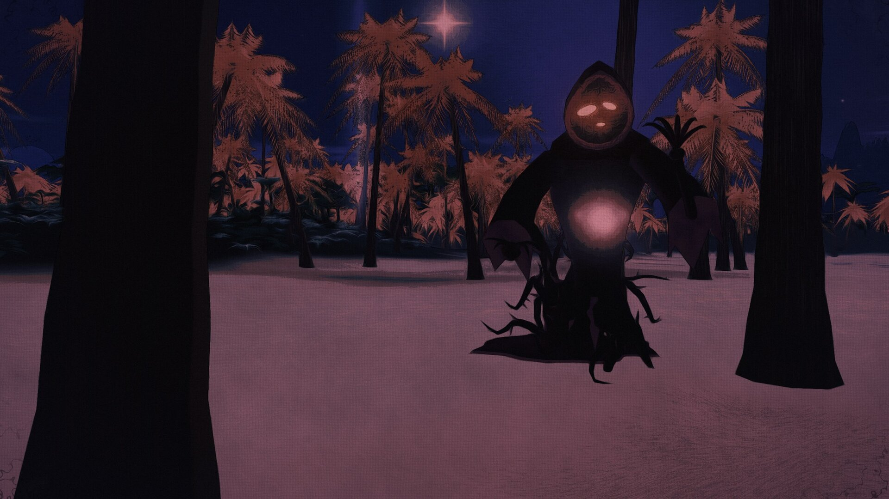
  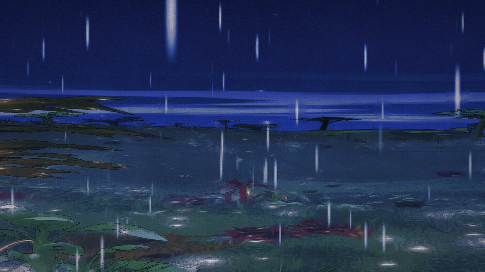
</p>
<p align="center">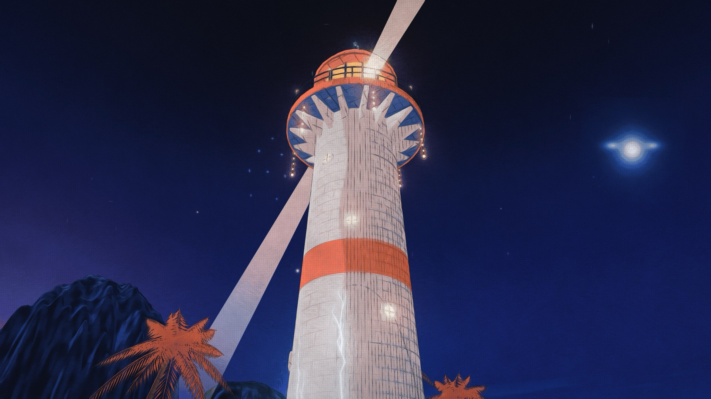</p>

**The lighthouses are places you go into.** A spiral stair winds up inside each tower, lit in warm pools by wall lanterns and in cold blue by the rune circle on the floor. At the top is the lamp room, where you rest and lift your stars, and a gallery that looks out over the island.

<p>
  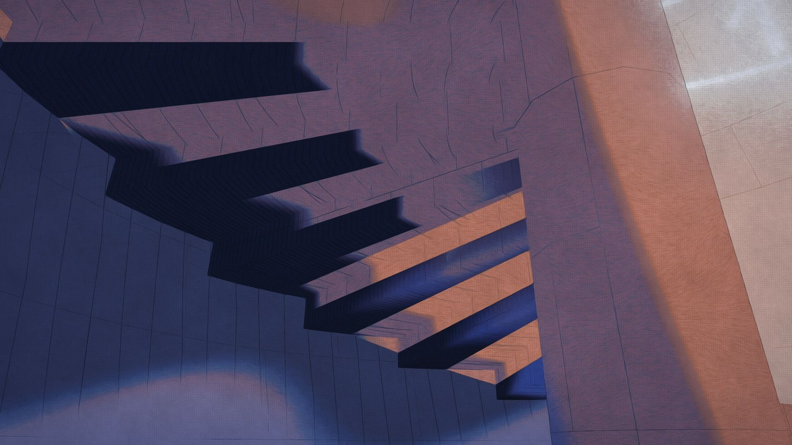
  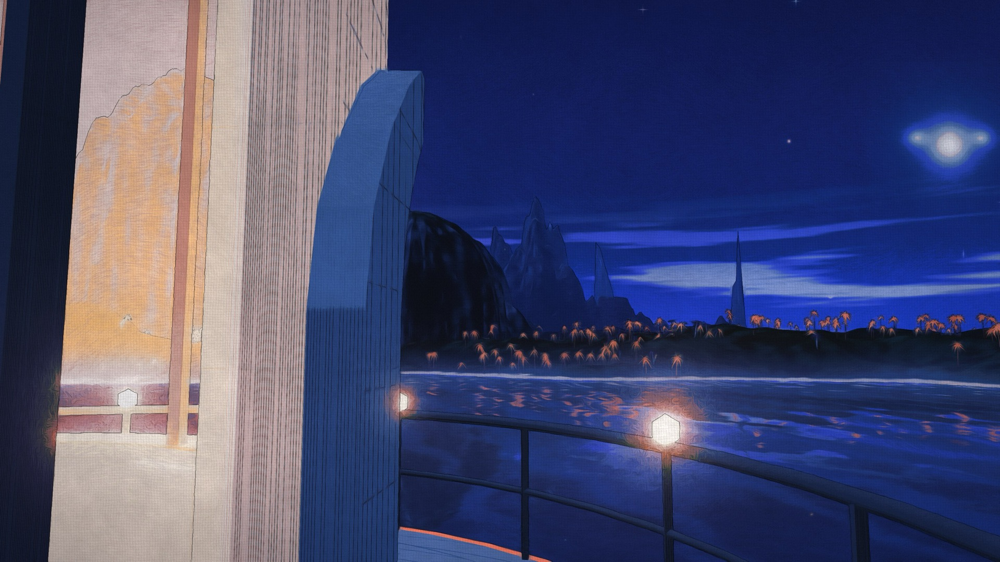
</p>

---

## The island

About 27 km² of land, shaped by a deterministic heightfield: granite domes rising straight out of the sea, ridged highlands, a lake with the Keeper's lighthouse on its islet, the River of Light running north, and secret lagoons behind rings of rock, reached by jumping across stepping stones, each with a waterfall pouring in.

| Region | Constellation | What it is like |
|---|---|---|
| Coral Shore | The Boat | where you wake: glowing coral palms, wet sand that mirrors the sky, surf that burns cyan as it breaks, the boat |
| Moonlit Meadows | The Hand | rolling open hills, moonflowers, glow-worms in the grass, drifting pollen, herds of star deer, the Moon Tree |
| Lantern Wood | The Lantern | violet moss, giant mushrooms freckled with twinkling light, lantern trees, rising spores, moth swarms |
| Glass Dunes | The Whale | wind-combed lilac dunes that glitter as you pass, crystals with light climbing them, a whale skeleton, a slow giant tortoise |
| Drowned Town | The Bell | a sunken town knee-deep in the sea, sea light pulsing through the old paving, a leaning bell tower |

Every region glows in its own way, and the undergrowth is never just green: dark and light greens, browns, plums and maroons in patches, with blossoms on the bushes.

<p>
  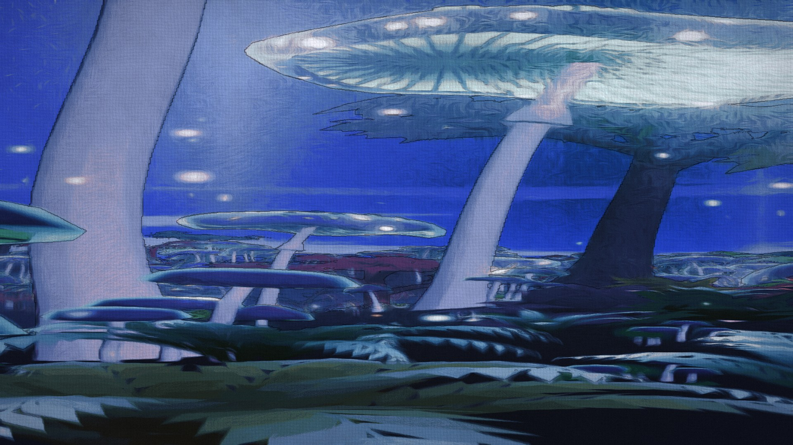
  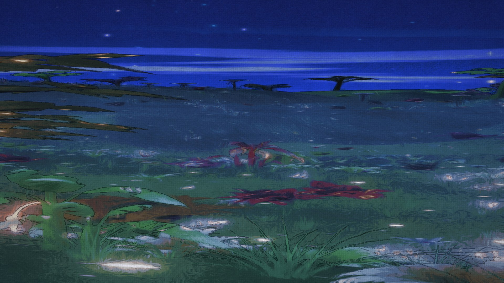
</p>
<p>
  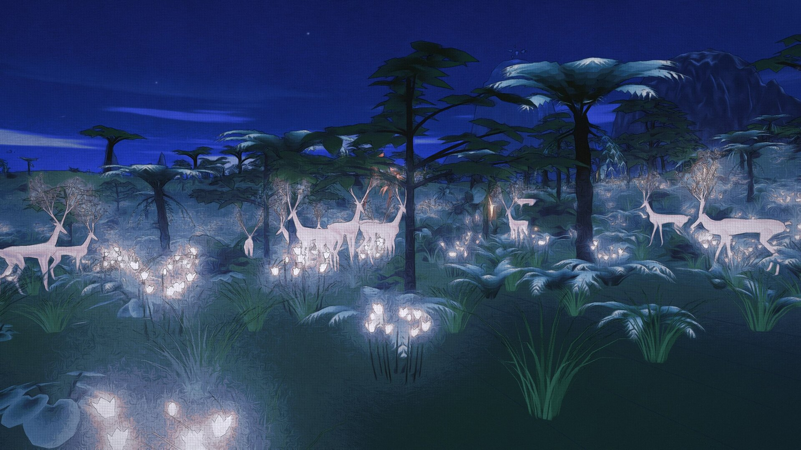
  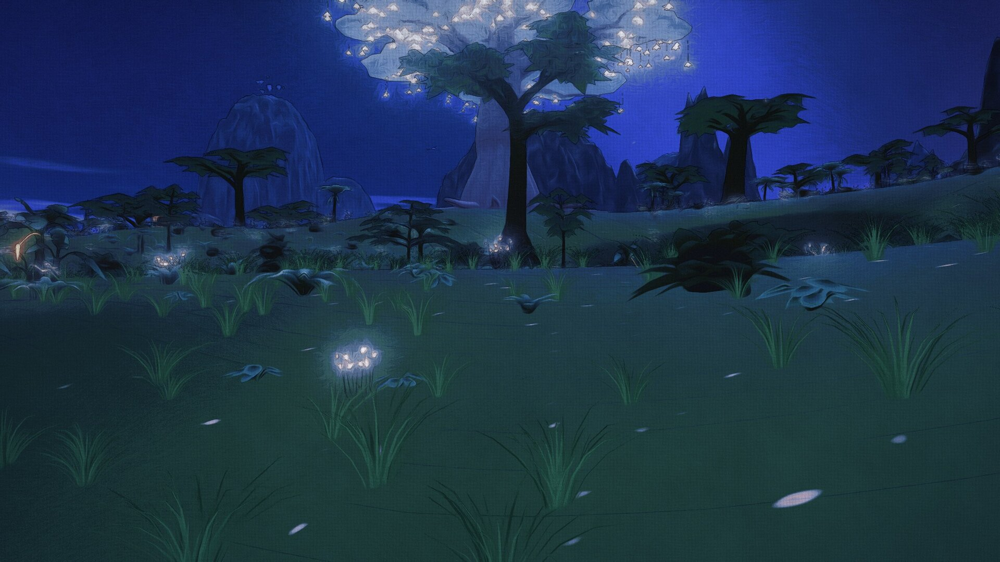
</p>
<p>
  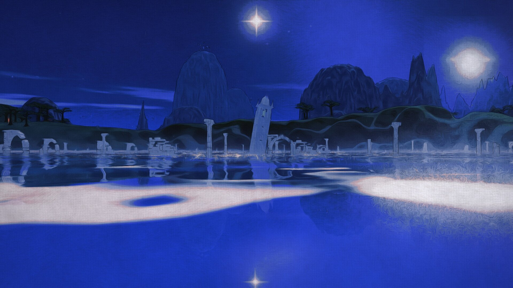
  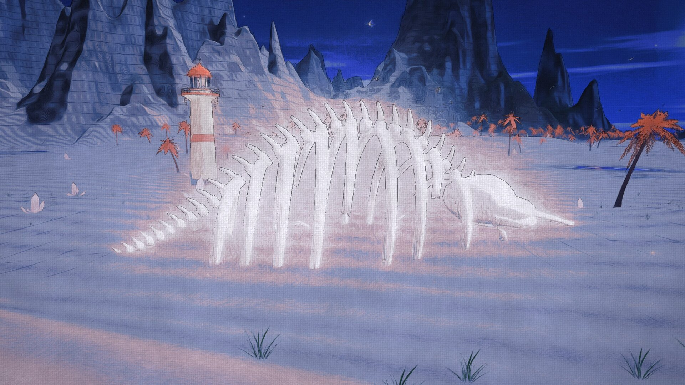
</p>
<p align="center">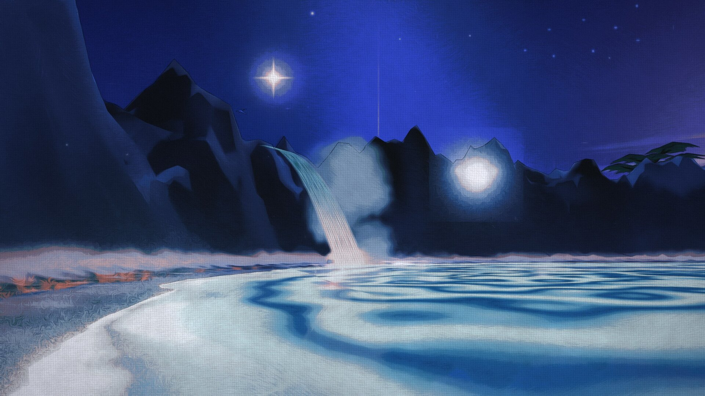</p>

---

## Puzzles

Each region has its own puzzle language, and each puzzle guards a star.

- **The firefly jar** (meadows): find a moonflower, put it in Mara's jar to open it, then herd a shy swarm of fireflies into it. Run or crowd them and they scatter home.
- **Footprints in the dew** (meadows): follow her small footprints through the grass. They only show up close, and only while you walk. Yours walk beside hers and fork off to dead ends.
- **Glowcaps** (Lantern Wood): mushrooms joined by roots; touching one flips it and every mushroom it reaches. Light them all at once, before they gutter out.
- **Mirror caps** (Lantern Wood): turn mirror caps to bounce a beam of light to the shrine, touching every cap on the way.
- **Sky stones** (dunes): each standing stone carries a dial of sky pictures. Turn each to show what it is looking at: the constellation in the direction it faces. The clue is the real sky.
- **Drowned bells** (Drowned Town): ring the bells in order. The order is written above them, but only the water remembers it, and only when the water is still. In the last pool the bells' own marks lie.

The puzzles were tuned with simulated playtesters (novice, casual, skilled, expert bots that play the real puzzle logic in fast-forward); see [docs/PLAYTEST.md](docs/PLAYTEST.md).

<p>
  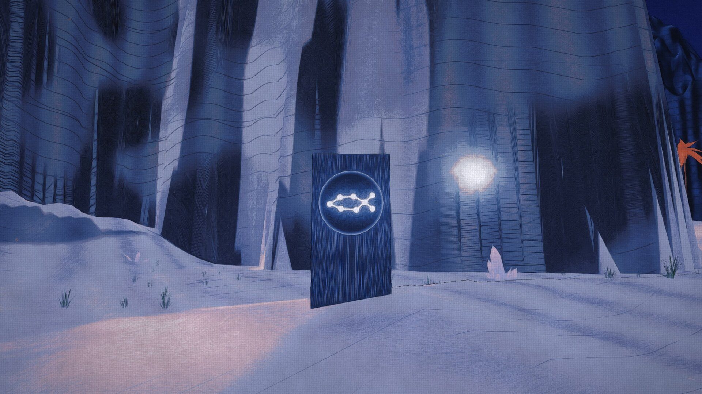
  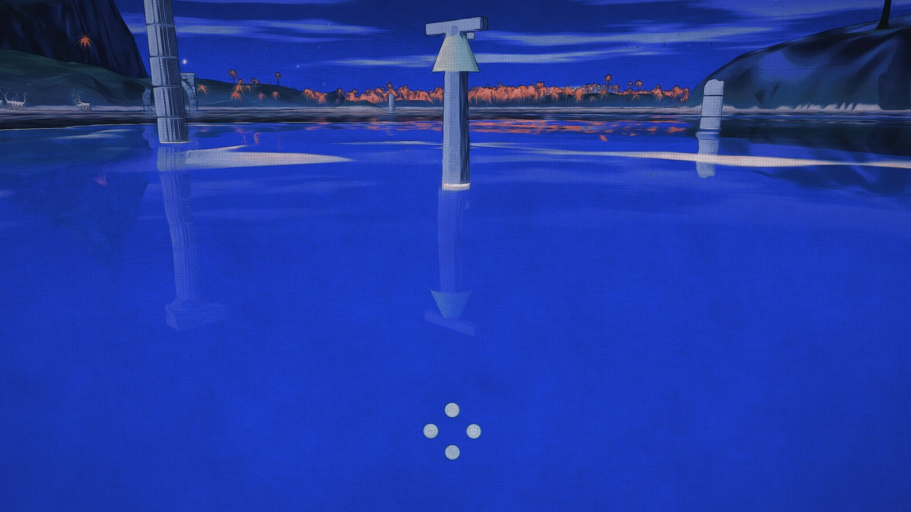
</p>

---

## The look: a moving drawing

The art direction comes from unseenai's paintings: ultramarine night, coral palms, four-point star glints, cream foam. The renderer works hard to make the world read as a drawing rather than a 3D scene.

- **Painterly post-process** (`src/render/post.ts`): a structure tensor finds which way every contour runs, then a line integral along that flow smears colour into brush strokes with bristles. Colours are pulled onto a hand-picked palette in Oklab, ink lines come from depth and tone and wobble at a "boil" rate like hand-drawn animation, and it all sits on an embossed canvas texture.
- **Drawn, not lit** (`src/render/drawn.ts`): terrain, trees, buildings and props get flat moonlight tones with wobbly edges, and pen hatching in shadow at a constant density on screen (the spacing doubles with each doubling of distance), laid in broken strokes and patches the way an illustrator works. Hills carry contour lines, cliffs carry strata, mushroom gills are inked radial lines.
- **Special states**: memories wash the screen into a risograph duotone; the cold and the night running out drain the colour and grow frost from the edges; nightmares curdle it toward crimson with ink veins creeping in; squalls wash it toward rain-grey, with lightning.
- **Colour grading** (`src/render/grade.ts`): each chapter can carry its own `.cube` LUT, graded from a screenshot in Resolve or Photoshop, and the look crossfades as you walk between regions. It ships neutral; add moods in `GRADES` in `src/config.ts`.
- **Steady frame rate**: the render resolution adapts to hold 60fps (aware of 75 to 144Hz displays), far props and puzzles drop out of the scene, and empty plant batches cost nothing.
- **The chart** (M) is hand-inked from the heightfield and revealed only where you have been.

<p align="center">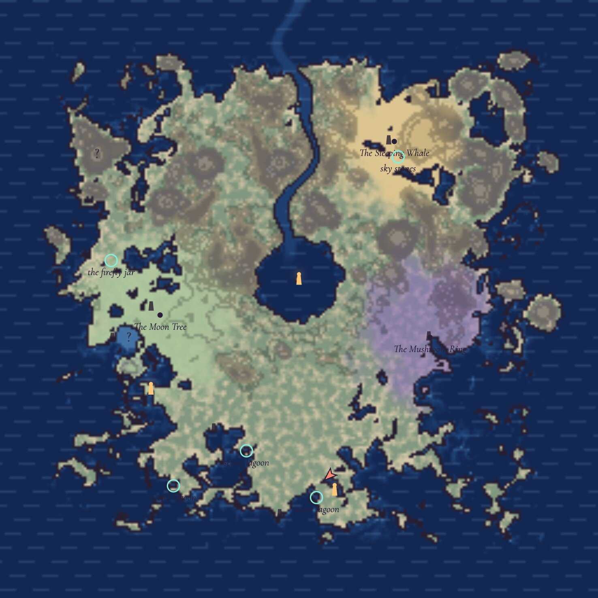</p>

---

## Sound and music

- **Score**: composed in Suno, instrumental only, one track per area (Coral Shore, the jungle, beyond the sea, dark water), a storybook theme, a memory sting, an ending, and a nightmare track that rises as they close in. Areas crossfade and rest between tracks.
- **Sound effects** (`tools/audio/build_sounds.py`): every footstep, oar stroke, splash, chime, bell, the whale song, the little light's calls, the surf, the waterfalls and the dread layer are synthesised offline from shaped noise and oscillators with numpy. Loops are built to be seamless.
- **Voice**: Mara's lines are text by default; recorded files dropped into `public/audio/voice/` are picked up automatically and processed so they sound remembered. Script and direction in [docs/VOICE.md](docs/VOICE.md).

---

## Controls

| Key | Action |
|---|---|
| W A S D | walk |
| Mouse | look |
| Shift | run |
| C (hold) | creep: slow and quiet, hard to see in the dark grass |
| Space | jump (hold in the air with moth wings to glide); long stroke in the boat as the oars dip |
| E | gather, read, light a lamp, pick up, ring, turn; step into or out of the boat |
| Hold E | at the water's edge: call the boat |
| F | ask the little light what to do next |
| Q | the little light flares: nearby nightmares burst (costs a pip of carried light) |
| M | the chart |
| I / Tab | the satchel: keepsakes, carried stars, her sky (click a keepsake to hold it) |
| 1 to 5 | hold up a keepsake; press again to put it away |
| Esc | pause: settings (graphics, sound, mouse, Wander / Story / Survival), controls, start over |

---

## Running it

Needs a browser with WebGPU (recent Chrome, Edge or Safari) and Node 20+.

```bash
npm install
npm run dev
```

Then open `http://localhost:5180`. `?reset` starts a fresh save; `?debug` adds a stats line and a `lapis` console object (`lapis.view(x, z)`, `lapis.playtest(50)`, and more).

```bash
npm run build      # typecheck and production build into dist/
npm run assets     # regenerate every model with headless Blender
npm run playtest   # headless simulated playtesters (optional run count, e.g. 200)
npm run check:core # fail if src/core imports anything engine-specific
npm run check:survival    # headless checks that stealth, packs, cold, squalls and Dark Water stay fair
npm run probe:lighthouse  # walk the player into every lighthouse wall, stair and rail looking for gaps
dotnet run --project sbox/Lapis.Parity   # C# port parity against the TypeScript traces
```

Sound effects: `tools/audio/.venv/bin/python tools/audio/build_sounds.py` (numpy).

Memory films: `python3 tools/memories/make_all.py` generates any missing ones (Viggle's video model, key in `.env.local`) and finishes each in Tesseract (`tools/memories/edit_memory.py`: the painted, hazy look, the scene's ambience under the memory swell).

---

## How it is built

```
src/
  core/              engine-free game rules: heightfield, player controller, night clock,
                     survival (warmth, light, rests), Dark Water, squalls, nightmare brain
                     (senses, packs), puzzle layouts and rule machines, deer herd,
                     keepsakes, progress and saves, simulated playtesters
  main.ts            boot, game loop, input wiring, menus
  config.ts          palette, sky, quality presets
  render/            painterly post-process, drawn shading, colour grading, adaptive
                     resolution, Dark Water and weather fields
  world/             streamed terrain (worker pool, LODs), flora, water,
                     sky, landmarks and lighthouses, wildlife and fauna, wonders,
                     puzzles, nightmares, waterfalls
  game/              avatar, camera rig, the little light
  story/             story flow, constellations, fallen stars, keepsakes, narrative overlay
  audio/             audio buses, synthesised sounds, music director
  ui/                pause menu, chart, satchel, hotbar, light gauge, memory films
sbox/                C# pilot port (Lapis.Core, parity runner, s&box component wrappers)
tools/
  parity/            TypeScript trace recorder for the C# parity tests
  blender/           headless Blender scripts that build every model (glb + FBX)
  audio/             offline sound synthesis
  memories/          memory film generation and finishing (Viggle, Tesseract)
  survival-check.ts  headless survival rules checks
docs/                story bible, game design, music, voice script, playtest report
```

- **Engine**: Three.js r186 `WebGPURenderer` with TSL node materials throughout; a custom `RenderPipeline` for the post-process.
- **World**: a deterministic heightfield sampled in a worker pool that builds terrain chunks with LODs and skirts and scatters flora by rules per region; flora is instanced in distance bands.
- **Rules are engine-free** (`src/core`, enforced by `npm run check:core`): the player controller, night clock, puzzles, nightmares, herd and progress are plain deterministic TypeScript that the Three.js renderers only read from. That is what lets the playtesters run headless and the game move to s&box.
- **s&box port**: the player controller, night clock, survival rules, Dark Water and squalls are already in C# (`sbox/`), matching the TypeScript to within 1e-15 over fifteen recorded scenarios (the squalls' random rhythm bit for bit). [docs/SHADERS.md](docs/SHADERS.md) specifies every shader for the HLSL rewrite.
- **Assets** are code: `tools/blender/*.py` build the flora, boat, props, fauna, wonders, the climbable lighthouse and the nightmares, export glb for the game and FBX for other engines, and encode sway and walk-cycle data in vertex colours for the shaders.

## Documents

- [docs/STORY.md](docs/STORY.md): the story bible
- [docs/GAME.md](docs/GAME.md): how the game plays
- [docs/SURVIVAL.md](docs/SURVIVAL.md): warmth, light, nightmares, Dark Water and squalls
- [docs/MUSIC.md](docs/MUSIC.md): the score and the Suno prompts
- [docs/VOICE.md](docs/VOICE.md): Mara's lines and recording direction
- [docs/PLAYTEST.md](docs/PLAYTEST.md): simulated playtest results
- [docs/SHADERS.md](docs/SHADERS.md): shader spec for the s&box port
- [sbox/README.md](sbox/README.md): the C# pilot and parity tests
